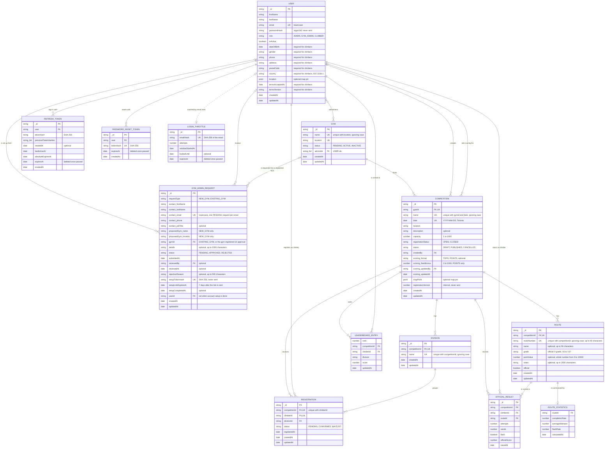

# TopSend Domain Model

## 1. Domain overview

The TopSend domain focuses on competition management, role-based access, scoring, and route intelligence. It is based on the user stories, requirements, and MVP definition in the documentation and intentionally separates official competition data from AI guidance.

Every entity is a MongoDB document. Its ID is `_id`, an ObjectId that the API sends as a 24-character string, and a field that refers to another entity holds that entity's `_id`. Dates are sent as ISO 8601 strings. The database sets `createdAt` and `updatedAt`.

## 2. Core entities

### User

```ts
interface User {
  _id: string;
  firstName: string;
  lastName: string;
  email: string;
  passwordHash: string;
  role: 'ADMIN' | 'GYM_ADMIN' | 'CLIMBER';
  isActive: boolean;
  dateOfBirth?: string;
  gender?: 'MALE' | 'FEMALE' | 'PREFER_NOT_TO_SAY';
  phone?: string;
  address?: string;
  postalCode?: string;
  country?: string;
  location?: { type: 'Point'; coordinates: [number, number] };
  termsAcceptedAt?: string;
  termsVersion?: string;
  createdAt: string;
  updatedAt: string;
}
```

**Invariants**
- A User must have exactly one active role at a time.
- A VISITOR is someone without an account, so VISITOR is never stored as a role.
- Passwords must not be stored in plain text. `passwordHash` is an argon2id hash and is never sent to the client.
- Emails are stored in lowercase and are unique.
- `dateOfBirth`, `gender`, `phone`, `address`, `postalCode`, `country`, `termsAcceptedAt`, and `termsVersion` are required for CLIMBER accounts and come from sign-up. `country` is an ISO 3166-1 alpha-2 code. `location` is the optional map pin, a GeoJSON point in `[longitude, latitude]` order.
- Visitors cannot access protected resources without authentication.

### Gym

```ts
interface Gym {
  _id: string;
  name: string;
  location: string;
  status: 'PENDING' | 'ACTIVE' | 'INACTIVE';
  adminIds: string[];
  createdAt: string;
  updatedAt: string;
}
```

**Invariants**
- The name and location together are unique, ignoring case.
- `adminIds` lists the Users who administer the gym. A gym can have none, one, or many. A User can be added only while their account is an active GYM_ADMIN with an APPROVED GymAdminRequest for this gym.
- A Gym Administrator can manage a gym's competitions only while the gym is ACTIVE.
- A competition can be created only for an ACTIVE gym. Deactivating a gym keeps its competitions but takes them out of competition discovery and Event Details, stops new registrations, and stops its Gym Administrators from managing them until the gym is activated again. A Climber who registered can still check their registration status.

### GymAdminRequest

```ts
interface GymAdminRequest {
  _id: string;
  requestType: 'NEW_GYM' | 'EXISTING_GYM';
  contact: {
    firstName: string;
    lastName: string;
    email: string;
    phone: string;
    jobTitle?: string;
  };
  proposedGym?: { name: string; location: string };
  gymId?: string;
  details?: string;
  status: 'PENDING' | 'APPROVED' | 'REJECTED';
  submittedAt: string;
  reviewedBy?: string;
  reviewedAt?: string;
  rejectionReason?: string;
  setupTokenHash?: string;
  setupLinkExpiresAt?: string;
  setupCompletedAt?: string;
  userId?: string;
  createdAt: string;
  updatedAt: string;
}
```

**Invariants**
- A Visitor sends a request without an account (US-034). `contact` is how a System Administrator reaches them: the first and last name, the email (stored in lowercase), and the phone are required, and the job title is optional. `details` is optional, up to 1000 characters.
- A NEW_GYM request carries `proposedGym`, the gym's name and location. No Gym exists until the request is approved, which registers the gym as ACTIVE and sets `gymId` to it. An EXISTING_GYM request carries the `gymId` of a registered gym.
- A new request is refused while its email has a TopSend account, a PENDING request, or an APPROVED request whose account setup isn't done.
- A request cannot grant admin access without System Administrator approval. Only an ADMIN reviews a request, and only once: `reviewedBy`, `reviewedAt`, and for a rejection an optional `rejectionReason` of up to 500 characters, which the applicant's email includes.
- Approval is refused when the email already has a TopSend account, when the proposed gym has been registered since the request was sent, or when the selected gym no longer exists.
- Approval emails a setup link that works once and expires after 7 days. Until setup is done, an ADMIN can send a new link, which replaces the old one and also lasts 7 days. Only a SHA-256 hash of its token is stored (`setupTokenHash`), and it is never sent to the client. Completing setup creates the applicant's GYM_ADMIN account, adds it to the gym's `adminIds`, sets `userId` and `setupCompletedAt`, and removes the link.
- Rejected requests must not create GYM_ADMIN privileges.
- An APPROVED request for a gym is what allows a User to be assigned to that gym, whether by account setup or by an ADMIN.

### Competition

```ts
interface Competition {
  _id: string;
  gymId: string;
  name: string;
  date: string;
  location: string;
  description?: string;
  capacity: number;
  registrationStatus: 'OPEN' | 'CLOSED';
  status: 'DRAFT' | 'PUBLISHED' | 'CANCELLED';
  createdBy: string;
  scoring?: {
    format: 'TOPS' | 'POINTS';
    flashBonus: number;
    updatedBy: string;
    updatedAt: string;
  };
  mapPoint?: { type: 'Point'; coordinates: [number, number] };
  registrationVersion: number;
  createdAt: string;
  updatedAt: string;
}
```

**Invariants**
- A competition belongs to exactly one gym.
- The competition must remain associated with the gym that created it.
- A gym cannot have two competitions with the same name on the same date, ignoring case.
- `date` is a calendar date in Toronto, sent as `YYYY-MM-DD`. When a competition is created, or its date is changed, the date must be from today up to two years ahead.
- `capacity` is the maximum number of participants: a whole number from 1 to 1000, and never below the number of CONFIRMED registrations.
- A new competition is a DRAFT with registration CLOSED. If no location is given, it takes its gym's location. `createdBy` is the Gym Administrator who created it.
- Opening registration on a DRAFT makes it PUBLISHED, so climbers can find it. Closing registration later keeps it PUBLISHED and stops new registrations.
- Capacity and registration state are enforced for event registration.
- `name` is up to 100 characters, `location` up to 200, and `description` up to 2000.
- `scoring` is left out until a Gym Administrator of the competition's gym chooses a format (US-018). There is one format for the whole competition, so every division is scored the same way. TOPS: the most problems topped wins, and ties go to fewer attempts on those problems. POINTS: each topped problem earns its point value, plus the optional flash bonus, and ties go to more tops, then fewer attempts. `flashBonus` is a whole number from 0 to 1000 and applies to POINTS only; TOPS stores 0. The format can't be changed once the competition is CANCELLED or its date has passed. On October 21 the team chose the Week 3 scoring model instead (each problem's points, minus a set percentage for each failed attempt, up to a maximum number of attempts), so these formats will change before result entry (US-019) uses them.
- `mapPoint` is the competition's optional map pin, a GeoJSON point in `[longitude, latitude]` order (US-025, US-027). The API sends it as `coordinates: { lat, lng }`, or `null` when no pin is set. The Map View can still pin a competition without one at its address; that lookup isn't stored.
- `registrationVersion` is an internal counter that is never sent to the client. Each registration advances it inside its transaction, and a capacity change is saved only when it hasn't moved, so capacity never drops below the CONFIRMED registrations even when both happen at once.

### Division

```ts
interface Division {
  _id: string;
  competitionId: string;
  name: string;
  createdAt: string;
  updatedAt: string;
}
```

**Invariants**
- A division belongs only to the selected competition.
- A competition can't have two divisions with the same name, ignoring case. A name is up to 50 characters.
- Division assignment must be valid for that competition: a Climber is only placed in a division of the competition they registered for.

### Route

```ts
interface Route {
  _id: string;
  competitionId: string;
  routeNumber: string;
  name?: string;
  grade: string;
  pointValue?: number;
  notes?: string;
  official: boolean;
  createdAt: string;
  updatedAt: string;
}
```

**Invariants**
- Route grade is an official setter-assigned value and cannot be automatically rewritten by AI.
- A route must belong to a valid competition, and it stays in that competition.
- A competition can't have two routes with the same number, ignoring case. The number identifies the route and is required, up to 40 characters. The name is optional, up to 50 characters.
- `grade` is an official V-grade from V0 to V17, such as V4. Every saved route is official.
- `pointValue`, when set, is a whole number from 0 to 10,000. `notes` are up to 2000 characters.

### Registration

```ts
interface Registration {
  _id: string;
  competitionId: string;
  climberId: string;
  divisionId: string;
  status: 'PENDING' | 'CONFIRMED' | 'WAITLIST';
  registeredAt: string;
  createdAt: string;
  updatedAt: string;
}
```

**Invariants**
- A climber cannot exceed the competition capacity.
- Duplicate registrations for the same competition and climber are rejected.
- Only CONFIRMED registrations count as registered Climbers.
- A Gym Administrator can change a registration's division or remove the registration. The Climber's account and their other registrations stay.

### OfficialResult

Not built yet (US-019).

```ts
interface OfficialResult {
  _id: string;
  competitionId: string;
  climberId: string;
  routeId: string;
  attempts: number;
  sends: number;
  flash: boolean;
  officialScore: number;
  savedAt: string;
}
```

**Invariants**
- Results are authoritative and cannot be modified by AI.
- A result must reference a valid competition, climber, and route.
- Partial saves are not allowed.

### LeaderboardEntry

Not built yet (US-020, US-032). Derived from official results.

```ts
interface LeaderboardEntry {
  rank: number;
  competitionId: string;
  climberId: string;
  division: string;
  score: number;
  updatedAt: string;
}
```

**Invariants**
- Leaderboard values are derived from official results only.
- Rank order must be deterministic and reproducible from the source results.

### RouteStatistics

Not built yet (US-022). Derived from official results.

```ts
interface RouteStatistics {
  routeId: string;
  completionRate: number;
  averageAttempts: number;
  flashRate: number;
  calculatedAt: string;
}
```

**Invariants**
- Statistics are computed from official results only.
- A route without result data shall show no statistics or an explicitly empty state.

### Supporting records for login

These records support US-001 and are not part of the competition domain.

```ts
interface RefreshToken {
  _id: string;
  user: string;
  tokenHash: string;
  previousTokenHashes: string[];
  rotatedAt?: string;
  lastActiveAt: string;
  absoluteExpiresAt: string;
  expiresAt: string;
  createdAt: string;
}

interface PasswordResetToken {
  _id: string;
  user: string;
  tokenHash: string;
  expiresAt: string;
  createdAt: string;
}

interface LoginThrottle {
  _id: string;
  emailHash: string;
  attempts: number;
  windowStartedAt: string;
  lockedUntil?: string;
  expiresAt: string;
}
```

**Invariants**
- A RefreshToken is one login session on one device. Only hashes of its secrets are stored, and the secret changes on every refresh.
- A PasswordResetToken is one unused reset link. Only a hash of the link's token is stored, and using a link deletes every link of that account.
- A LoginThrottle counts failed logins for one email, stored as a SHA-256 hash. It has no link to a User, so a lock works the same way for an email without an account.
- MongoDB deletes each of these records after its `expiresAt`.

## 3. Aggregates and lifecycle

### User aggregate
- contains user profile and role metadata
- lifecycle: Visitor -> CLIMBER through sign-up (US-002), or Visitor -> GYM_ADMIN after a System Administrator approves their request and they complete account setup (US-034, US-035)

### Gym aggregate
- contains gym metadata and assigned admins
- lifecycle: a gym an ADMIN adds is ACTIVE unless another status is chosen, and a gym registered by approving a NEW_GYM request is ACTIVE. An ADMIN can deactivate a gym, and can activate a PENDING or INACTIVE one.

### Competition aggregate
- contains competition metadata, divisions, route list, and registrations
- lifecycle: DRAFT -> PUBLISHED when its registration first opens. While PUBLISHED, registration can be OPEN or CLOSED. CANCELLED is kept for cancelled competitions; no story cancels one yet.

### Result aggregate
- contains official result entries and derived leaderboard data
- lifecycle: saved -> recalculated -> exposed to scorecards and leaderboards

## 4. Policy rules

- Only administrators or authorized gym staff may change official competition data.
- AI can explain route difficulty, completion, and ranking difference but cannot update route grades, scores, or winners.
- A non-authorized user must never observe private scorecards or competition management functions.
- A competition with registration CLOSED, or one that is full, stays closed to further valid registrations.

## 5. Key domain decisions

- The system models official results as a trusted source of truth.
- AI-generated guidance is derived, not authoritative.
- Role and gym authorization are encoded as first-class invariants.
- Registration and scoring workflows remain separate to preserve data integrity.
- Opening a draft's registration also publishes it, so a Gym Administrator needs no separate publish step. Competition discovery (US-025) shows only PUBLISHED competitions.

## 6. Entity relationship diagram

The diagram follows the models in server/src/models and the entities above. OfficialResult, LeaderboardEntry and RouteStatistics aren't built yet, so they follow this document. PK marks an entity's `_id`, FK a field that holds another entity's `_id`, and UK a value that must be unique. A dotted line is a match that isn't stored as a reference.


